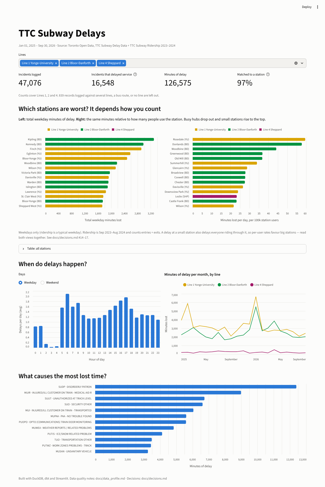
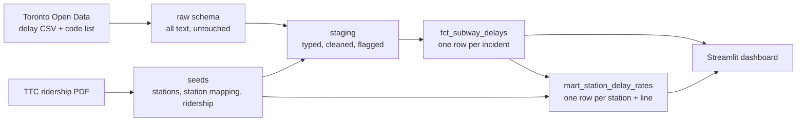

# TTC Subway Delays

An end-to-end analytics pipeline on Toronto's subway delay data: raw CSVs in, tested tables and a dashboard out.

**Stack:** Python · DuckDB · dbt · Streamlit



## What it found

- **The "worst" station depends on how you count.** By total minutes lost, Kipling, Kennedy and Finch lead. Relative to how many people use each station, Rosedale and Donlands lead, and the busiest hubs (Union, Bloor-Yonge, St. George) come out as the least delay-prone.
- **65% of logged incidents caused no delay at all.** They are real events (a disorderly patron, an alarm) that didn't stop service, so counting incidents and measuring lost time give very different pictures.
- **Delays peak at the commutes** (5–8am and 4–6pm on weekdays) **and spike in winter** (Feb 2025, Jan 2026).
- **Disorderly patrons are the top cause of lost time**, ahead of any equipment fault.
- **Weekend delays mainly due to operational/maintenance issues/delays

## How it works



| Layer | What it does |
|---|---|
| `raw` | CSVs loaded as-is, every column text. Never fails on a format change. |
| `staging` | Casts types, repairs encoding, maps station names, flags problems. No rows dropped. |
| `marts` | `fct_subway_delays` (47,915 incidents) and `mart_station_delay_rates` (74 station-lines with ridership). |
| `seeds` | Hand-reviewed reference data: the station master list, the station name mapping, ridership. |

## The data problems, and what I did about them

The interesting part of this project is the data quality work. Full detail is in [docs/data_profile.md](docs/data_profile.md) and every judgment call is logged in [docs/decisions.md](docs/decisions.md).

| Problem | Decision |
|---|---|
| `Station` is free text: 1,265 spellings for 70 stations ("KENNEDY BD STATION (PL…", "UNION TO ST ANDREW") | A reviewed mapping table ([seeds/station_mapping.csv](seeds/station_mapping.csv)) with a mapping type per row. 95.7% of incidents map to a station; the rest are labelled line-level, facility or unmapped rather than forced. |
| Interchange stations serve two lines, with separate ridership | Station grain is station + line. |
| 11 delay codes (1,892 rows) are missing from TTC's code list | Left join, so no delays are lost; a dbt test warns on every run. |
| 66 pairs of identical rows | Flagged, not deleted: double entry and two real events look the same. |
| The `Day` column is wrong for one date; code descriptions have broken characters | Weekday recomputed from the date; encoding repaired in staging. |
| Per-station ridership exists only for Sep 2023–Aug 2024 | Used with the assumption stated; the extraction reconciles exactly to TTC's published line totals. |

**Tests:** 20 dbt tests pass. One warns by design (the missing codes), and another fires if a future data refresh brings station spellings that aren't mapped yet.

## Run it

Needs Python 3.12 or 3.13. The data files are included, so no download is needed.

```bash
python -m venv .venv
source .venv/Scripts/activate        # Windows Git Bash; use .venv/bin/activate on macOS/Linux
pip install -r requirements.txt

python db.py                         # load the CSVs into ttc.duckdb
dbt build --profiles-dir .           # build and test the models
streamlit run dashboard/app.py       # open the dashboard
```

`dbt` here means dbt-core from the virtual environment (`dbt --version` should show 1.x with the duckdb plugin).

## Project layout

```
data/raw/        source files from Toronto Open Data and TTC
scripts/         load.sql (raw load), build_station_mapping.py (one-off mapping draft)
seeds/           stations, station_mapping, station_ridership
models/staging/  stg_subway_delays, stg_delay_codes
models/marts/    fct_subway_delays, mart_station_delay_rates
tests/           custom data tests
dashboard/       Streamlit app
docs/            data profile and decision log
```

## Limits

- Per-rider rates describe how often things go wrong at a station relative to local use, not passenger impact: a delay at a small station also holds up everyone riding through it.
- Ridership is from 2023–24 and delays from 2025–26. Rankings assume each station's share of riders is stable.
- "A to B" locations (0.9% of incidents) are left out of the per-station rates.

## Next

Weather data to test the winter effect, a station drill-down view, and a delay prediction model with a simple baseline to beat.

## Data sources

- [TTC Subway Delay Data](https://open.toronto.ca/dataset/ttc-subway-delay-data/), City of Toronto Open Data (Open Government Licence – Toronto)
- TTC Subway Ridership 2023–2024, ttc.ca

## How this was built

Built with AI assistance (Claude) for much of the code and debugging. I directed the scope, reviewed the data decisions recorded in the decision log, and wrote and checked analysis queries myself.
